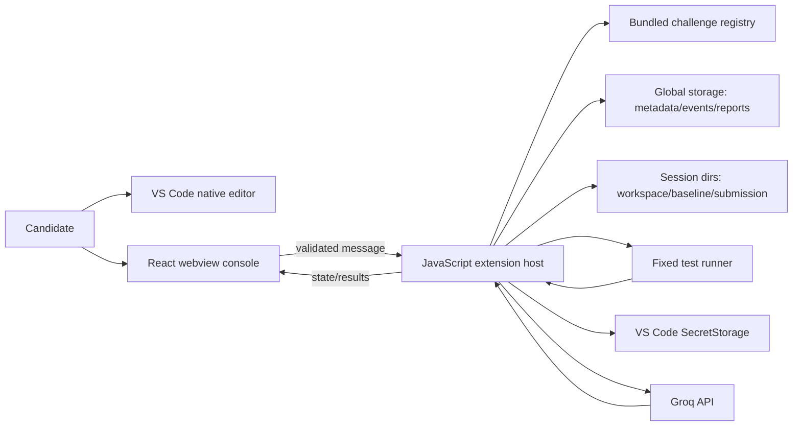

# Architecture

**Version 0.2:** The default command opens a `WebviewView` Assistant contributed to Explorer; users can move it to VS Code's Secondary Side Bar. The existing panel is now the optional Interview Lab. `src/companion.js` owns Assistant actions and VS Code workspace/editor context, `src/companionStore.js` stores bounded general conversations under `chats/`, `src/workspaceContext.js` validates source paths and size, and `src/patch.js` validates reviewable full-file proposals. The host, not React, calls Groq and applies a reviewed `WorkspaceEdit`.

Start Interview persists the unchanged session record and deadline before `vscode.openFolder` opens its writable workspace in a new VS Code window. Each extension host reads the shared global-storage session pointer independently; only the window whose workspace path matches the saved writable workspace automatically restores its editor, tree, timer, and interview operations. A start lock prevents simultaneous session creation in separate hosts. The candidate can open Interview Lab from the new window for tests, answers, submission, and reports. Window layout and second-window extension availability still need manual verification.

**Milestone 3 implementation:** The extension host uses `src/ai.js` for bounded workspace context, structured assessment validation, and evidence packaging, and `src/groq.js` for Groq Chat Completions requests through `fetch`. The API key stays in VS Code SecretStorage; the model ID is a VS Code setting. Chat is saved under the session, submitted answers are hash-checked, and versioned qualitative reports are saved as `report-vN.json`. Broader challenge support remains planned.

`src/evaluation.js` owns source fingerprints, snapshot manifests, the fixed subprocess, validated harness results, and deterministic correctness scoring. `challenges/retry-queue-v1/harness.js` imports only the supplied workspace or snapshot. The host persists run JSON under `sessions/<id>/runs/`, the submission under `sessions/<id>/submission/`, and objective state in `session.json`.

**Status:** four core workflows implemented for one bundled challenge; GUI behavior and live Groq calls still require manual verification. See [TECH_STACK.md](TECH_STACK.md) and [SECURITY.md](SECURITY.md).



| Component | Responsibility | Trust boundary |
|---|---|---|
| Webview | UI, display, typed intent messages | Untrusted input; no fs, shell or key |
| Extension host | Authoritative orchestration/validation | Only component with VS Code privileges |
| Registry | Bundled challenge metadata and fixed runner ID | Trusted packaged content |
| Session store | Metadata, events, reports, atomic record operations | Local private data |
| Workspace manager | Copies baseline, snapshots/diffs, canonical paths | Must reject traversal/symlinks as feasible |
| Runner | Starts allowlisted test command, parses bounded output | Candidate code is untrusted/non-hostile only |
| Groq client | Bearer-authenticated requests, timeout, safe errors, response parse | External network boundary |
| Scorer/report service | Deterministic metrics; validates qualitative evidence | Objective facts remain usable without AI |

## Data flow

`startInterview` is validated by the host, which creates the ID, deadline, baseline and workspace then persists `RUNNING`. Test requests use only the fixed runner. Submission records answers and transitions `RUNNING → SUBMITTING → EVALUATING → COMPLETED`, freezing files before final tests. The deterministic score is saved first. Groq receives bounded evidence from the same snapshot; locally validated qualitative output is saved as a versioned report. Missing or failed Groq access leaves the objective result available for retry.

Messages use a versioned discriminated union, e.g. `startSession`, `runTests`, `askAssistant`, `submit`, `retryAssessment`, and host events `sessionState`, `testResult`, `report`. Both direction payloads have schemas; unsupported action, malformed data, wrong session/state and stale IDs are rejected with safe error codes. The webview never supplies paths, commands, deadlines, API keys, or scores as authority.

## Storage layout

```text
globalStorage/
  sessions/<id>/session.json
  sessions/<id>/answers.json
  sessions/<id>/chat.json
  sessions/<id>/runs/<run-id>.json
  sessions/<id>/baseline/          # immutable bundled copy
  sessions/<id>/workspace/         # mutable candidate files
  sessions/<id>/submission/        # immutable final copy
  sessions/<id>/report-vN.json
```

Writes should use temporary files and rename where supported; on startup metadata is validated and incomplete transitions reconciled. The persisted `deadlineAt` is the timer authority. A final transition freezes submission before assessment, so later workspace edits cannot affect it.

## Error handling and trade-offs

Failures become explicit persisted states/events, never silent success. Recoverable AI/report failures are retryable; a runner timeout/error records an inconclusive run; corrupt records are quarantined/reported rather than interpreted. Local-first avoids backend/auth scope but means no device sync and candidate execution cannot be a security sandbox. Groq adds useful coaching but can be unavailable or incorrect, hence local validation and deterministic correctness.
