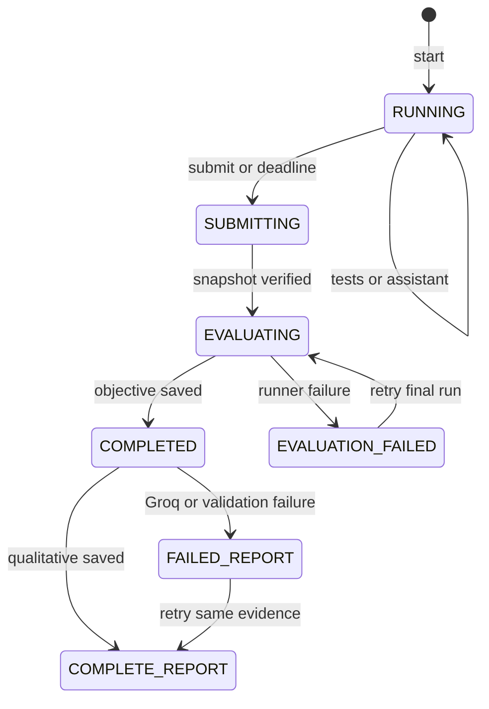

# Workflow Specification

**Assistant-first workflow:** Open Assistant → attach selected source context or enable targeted workspace search → send natural-language follow-ups → optionally request a structured edit → preview each proposed file in the native diff editor → explicitly apply or reject. Chats persist independently from interview data. Stop aborts the non-streaming request; a failed request leaves the user message retryable.

**Native interview handoff:** Start Interview saves one session and its absolute deadline, then opens the writable challenge folder using `vscode.openFolder` with `forceNewWindow`. The new host validates that its workspace path equals the saved session workspace, restores `queue.js` and Assistant, and exposes Interview Lab for the full test/submission/report workflow. If window opening fails, the saved session remains retryable through **Open Active Interview Workspace**.

**Milestone 3 implementation:** During `RUNNING`, the candidate may configure/test Groq and request explain, investigate, review, or fix guidance. Early submission saves four written answers before freezing files; timeout saves empty answers. After objective evaluation, qualitative status moves through `PENDING → RUNNING → COMPLETE` or `FAILED`. Retry uses the same snapshot, answers, and final run. On restart, interrupted `RUNNING` assessment becomes `FAILED` for explicit retry. The older state diagram below is conceptual; the implemented session states remain uppercase.

The session lifecycle is `RUNNING → SUBMITTING → EVALUATING → COMPLETED`, with `EVALUATION_FAILED` for retryable final-run faults. Expiry invokes the same submission path. A legacy `TIMED_OUT` record is migrated to `SUBMITTING` on recovery. Snapshot failure remains `SUBMITTING` and offers a safe retry.

All states and transitions are host-authoritative and persisted. The following diagram separates the session lifecycle from the qualitative report lifecycle:

| Workflow / transition | Handler | Persisted result | Failure behaviour |
|---|---|---|---|
| First launch / configure AI | command + settings/SecretStorage service | no key in session; configuration status event | missing/invalid key disables AI; rest remains usable |
| Select and start | registry + session/workspace service | ID, `active`, `startedAt`, `deadlineAt`, baseline/workspace/event | cleanup partial workspace; surface retryable setup error |
| Resume on restart | activation + recovery service | recalculated active/expired state | invalid record is not silently resumed |
| Investigate / ask AI | webview + host AI service | prompt mode, safe context summary, result/error event | validation/network/schema failure retains session |
| Run tests | runner service | test-run event with status/output summary | timeout/nonzero/parser failure shown as result, not score success |
| Early submit | submission + scoring service | immutable snapshot/diff/final test/event | duplicate/stale state rejected |
| Deadline submit | deadline guard before commands/activation | `expired`, then frozen snapshot/assessment attempt | no further mutable actions accepted |
| Report / retry | report service | objective report, final status; qualitative addendum | retry only qualitative portion |

## Detailed sequences

### First launch through active interview

The candidate optionally runs **Configure Groq**. Host validates the key with a non-secret-safe policy and stores it only in SecretStorage. Selecting the bundled challenge displays candidate-visible briefing. On Start, host records an absolute `deadlineAt`, creates/copies a clean workspace, persists durable metadata before telling the webview success, opens selected files, and enables the console.

### Investigation and assistance

Candidate edits through VS Code, not the webview. The webview sends an assistant mode plus bounded selection/question. Host checks session state/deadline, constructs minimum context from allowlisted session files, calls Groq, validates response, records an event and returns text. “Suggest” is explanatory only; it never writes a file. Missing selection, oversized context, bad message, key absence or API failure yields a clear message and leaves editing/testing available.

### Tests, submit, deadline, recovery

Run Tests uses a registry runner ID only. Host captures stdout/stderr with caps and records outcome. Submit locks transition under a session operation guard, checks deadline and whether a submission exists, freezes files/diff, runs evaluation, and calculates objective facts. If the deadline has elapsed on a command or extension activation, host changes to `expired`, blocks edits/actions, and performs the same snapshot path. On restart, it validates metadata and recomputes `now >= deadlineAt`; `submitting`/`assessing` records are reconciled from existing snapshot/results rather than re-freezing mutable files.

### Report edge cases

Objective scoring is produced without Groq. Valid structured qualitative feedback is merged only after every evidence ID refers to stored facts. Bad/contradictory output becomes `assessment_retryable`, with uncertainty disclosed. Disk write failure becomes `failed` with recovery guidance; no claimed report is shown until persistence succeeds.
